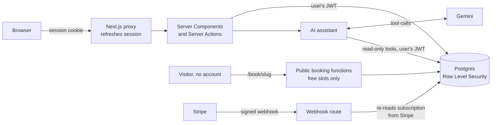

# TenantFlow

**Multi-tenant AI SaaS platform: tenant isolation, RBAC, AI chatbot, lead scoring, Stripe subscriptions.**

TenantFlow is a working reference build of the part of a SaaS MVP that is hardest to get right and most expensive to fix later: **many customers sharing one app, each seeing only their own data, with different permissions for different people on the same team.** Around that core it ships the features clients usually ask for next: an AI assistant, lead scoring, appointment booking and subscription billing.

It is a portfolio project, built with the same stack and standards I use for client MVPs: Next.js, Supabase (Postgres, Auth and Row Level Security), Stripe and an LLM API.

---

## The problem it solves

In almost every SaaS scoping conversation the same questions come up:

- *"If two companies use the app, how do we guarantee one can never see the other's data?"*
- *"Can managers do things normal users can't?"*
- *"How do free and paid plans limit what people can do?"*
- *"Can the AI answer questions about our data without leaking anyone else's?"*

Most MVPs answer these in the UI, by hiding buttons and filtering lists in JavaScript. That works until someone calls the API directly. **TenantFlow enforces every one of these rules in the database**, so a bug in the frontend, a forged request or a creative AI prompt still cannot cross the line. The UI mirrors the same rules so people only see what they can use.

## What's inside

| Feature | What it does | Where the rule is enforced |
|---|---|---|
| **Tenant isolation** | Every row belongs to one workspace; users see only theirs | Postgres Row Level Security on every table |
| **Roles (owner / admin / member)** | Invites, removals, role changes, billing and settings are permissioned | RLS policies and checked database functions |
| **Invitations** | Owners and admins invite by link; invitees join the right workspace | Sign-up trigger validates the token and email |
| **Plans & Stripe billing** | Free (3 seats, 25 AI messages/month) and Pro ($29, unlimited seats, 1,000 AI messages) | Limits enforced per row by database triggers; plan written only from verified Stripe data |
| **AI assistant (Gemini)** | Chat that answers questions about the workspace: team, leads, calendar, billing | Its tools query *as the signed-in user*, so RLS limits what it can see |
| **Lead scoring** | Transparent 0–100 score from fit, source and recency, with a reason for every point | One SQL function, shared by the UI and the assistant |
| **Appointment booking** | Public booking page per workspace, team calendar, bookings linked to leads | An exclusion constraint makes double-booking impossible |
| **Demo data** | Three realistic workspaces, reset with one command | `npm run seed` |

## How tenant isolation works



- **The workspace is never taken from the client.** Each request's workspace is derived in the database from the authenticated user (`private.current_tenant_id()`), so a client can't claim to be someone else.
- **Every table has RLS and a `tenant_id`.** Anonymous visitors have no table access at all; public features go through narrow functions that return only what a visitor may see (for example, free booking slots but never who booked them).
- **Write rules live next to the data.** Row-level rules ("admins can remove members, not admins") are RLS policies. Column-level rules ("only the owner can change a role") are checked database functions, because Postgres policies can't restrict individual columns. Server-only state (plan, Stripe IDs, AI usage) isn't writable by clients at all.
- **Guard tests catch regressions.** If a future table ships without RLS, without a `tenant_id`, or with any anonymous access, the test suite fails.

### Roles

| Action | Owner | Admin | Member |
|---|:---:|:---:|:---:|
| See workspace data, add leads, book meetings | ✓ | ✓ | ✓ |
| Edit leads and meetings | all | all | their own |
| Invite and remove members | ✓ | ✓ | – |
| Invite, promote or remove admins | ✓ | – | – |
| View billing | ✓ | ✓ | – |
| Change plan, rename workspace, transfer ownership | ✓ | – | – |
| Edit booking settings | ✓ | ✓ | – |

Nobody can remove themselves, change their own role, or remove the owner.

## The AI assistant, safely scoped

The assistant never gets its own database access. It can only call a small set of **read-only tools**: workspace overview, team, invitations, billing status, leads, lead score breakdown, pipeline summary and appointments. Every tool runs with **the signed-in user's own session**, so:

- it cannot see another workspace, whatever it is asked;
- it cannot see more than the user's role allows (a member asking about billing is told it isn't visible to their role);
- the model is instructed to treat user-typed data (such as lead notes) as data, not instructions, and because every tool is read-only, even a successful prompt injection can't change anything.

Conversations are private to their author, even from the workspace owner. Usage counts against the plan's monthly allowance in a private ledger, so deleting conversations doesn't refund it. Answers stream in, and the model falls back automatically when Gemini is overloaded.

## Lead scoring, explained

Every lead gets a score from 0 to 100, computed in one SQL function and shown with a reason for every point:

| Factor | Max | Scoring |
|---|---|---|
| Budget | 25 | $50k+ = 25 · $20k+ = 20 · $5k+ = 12 · any = 5 |
| Company size | 15 | 200+ = 15 · 50+ = 12 · 10+ = 8 · smaller = 3 |
| Source | 30 | Referral 30 · Demo request 28 · Webinar 20 · Search 18 · Paid ads 12 · Social 10 · Cold outreach 6 |
| Recency | 30 | ≤3 days = 30 · ≤7 = 24 · ≤14 = 18 · ≤30 = 10 · ≤90 = 4 |

**Hot** is 70 or more, **Warm** is 40–69 and **Cold** is below 40. Booking a meeting or logging engagement refreshes the recency score.

## Proof: what the tests verify

`npm run test:db` runs **152 pgTAP assertions** against the real database, each suite inside a transaction that is rolled back, so nothing persists.

| Suite | Assertions | Proves |
|---|---:|---|
| Tenant isolation | 22 | Cross-tenant reads and writes fail; anonymous access is denied; guard checks on every table |
| Auth & RBAC | 37 | Sign-up provisioning, invitation rules, every role boundary, ownership transfer |
| Billing | 19 | Clients can't upgrade themselves or forge billing; seat limits hold, including against bulk inserts |
| Assistant | 19 | Conversations are private; monthly limits hold against bulk inserts; deletions don't refund usage |
| Leads | 24 | Exact scores for known inputs; edit and delete rules; assignees must be in the same workspace |
| Appointments | 31 | Public booking, no double-booking, lead linking, per-email cap, cancellation, access rules |

Beyond the automated suite, each phase was checked in a real browser with users in separate workspaces, including direct API calls with a member's real session (promoting themselves, reading another workspace, forging a billing record, reading cancel tokens). All were refused by the database.

## Tech stack

- **Next.js 16** (App Router, Server Components, Server Actions, `proxy.ts`), **React 19**, **Tailwind CSS 4**
- **Supabase**: Postgres, Auth and Row Level Security; `@supabase/ssr` for cookie sessions
- **Stripe** (test mode): Checkout, Customer Portal, signed webhooks
- **Google Gemini** via `@google/genai`: streaming and function calling
- **pgTAP** for database tests

## Run it yourself

**Prerequisites:** Node 20+, a Supabase project (the free tier is fine), and optionally a Stripe test account and a Gemini API key.

```bash
npm install
cp .env.example .env.local        # fill in your Supabase URL and keys
npx supabase login
npx supabase link --project-ref <your-project-ref>
npx supabase db push              # applies the 7 migrations
npm run seed                      # 3 demo workspaces; logins go to .demo-credentials.local.md
npm run dev                       # http://localhost:3000
```

In the Supabase dashboard, turn off **Confirm email** (Authentication → Providers → Email) for a demo, or configure your own SMTP so confirmation emails reach real people.

**Optional:**

- **Stripe:** set `STRIPE_SECRET_KEY` (test mode), run `npm run stripe:setup` to create the Pro price, save the Customer Portal settings once in the Stripe dashboard, and point a webhook at `/api/stripe/webhook` with its secret in `STRIPE_WEBHOOK_SECRET`. Without keys, billing runs as a read-only demo.
- **Gemini:** set `GEMINI_API_KEY`. Without it, the assistant page explains that it isn't configured.

**Checks** (`test:db` needs a bash shell, such as Git Bash on Windows):

```bash
npm run test:db     # 152 database assertions
npm run typecheck
npm run lint
npm run build
```

## Demo workspaces

`npm run seed` wipes and recreates three workspaces; re-run it any time to reset the demo.

| Workspace | Plan | Shows |
|---|---|---|
| Northwind Traders | Pro | Full team across all roles, 12 leads from hot to cold, a busy calendar, a pending invite |
| Globex Health | Free | Seat limit reached (3 of 3), New York timezone |
| Acme Studio | Free | A small two-person team, London timezone |

Each has a public booking page at `/book/<workspace-slug>`. Logins (all emails use the reserved `.example` domain) are written to `.demo-credentials.local.md`, which is gitignored; re-seeding generates new passwords.

## Project structure

```
src/
  app/
    (auth)/            sign-up, login, invitations, no-workspace page
    (app)/             signed-in app: dashboard, leads, appointments, assistant, settings
    book/              public booking and cancellation pages (no account needed)
    api/chat/          streaming assistant endpoint
    api/stripe/        webhook and checkout return
    auth/confirm/      email and magic-link confirmation
  lib/
    auth.ts            current user, workspace and role (server-only)
    rbac.ts            the UI's copy of the permission rules
    billing.ts         plans and Stripe sync
    leads.ts           score display helpers
    appointments.ts    timezone-safe time handling
    assistant/         Gemini loop and the read-only tools
    supabase/          browser, server, proxy and admin clients
supabase/
  migrations/          schema, RLS policies, functions and triggers
  tests/database/      pgTAP suites
scripts/
  seed.mjs             demo data
  stripe-setup.mjs     creates the Pro product and price
  test-db.sh           runs the pgTAP suites against the linked project
```

## Deploying

The app deploys to any Next.js host (for example Vercel). Set the same environment variables, set `NEXT_PUBLIC_SITE_URL` and the Supabase **Site URL** to your domain, and create the Stripe webhook for the production URL.

## Honest limitations

This is a demo, and some choices reflect that:

- **Stripe runs in test mode.** Nothing can charge real money.
- **One workspace per user.** It keeps the model simple; multi-workspace membership would add a join table and a workspace switcher.
- **Email confirmation is off** in the demo project because Supabase's built-in mailer only delivers to the project team. Production needs your own SMTP.
- **Public booking is rate-limited per email** (3 upcoming bookings), not by IP or CAPTCHA.
- **Seeded Pro plans are demo state**, not backed by a real Stripe subscription.

---

Built by Imran Ahmed as a portfolio project for SaaS MVP clients.
